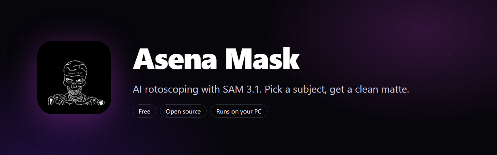
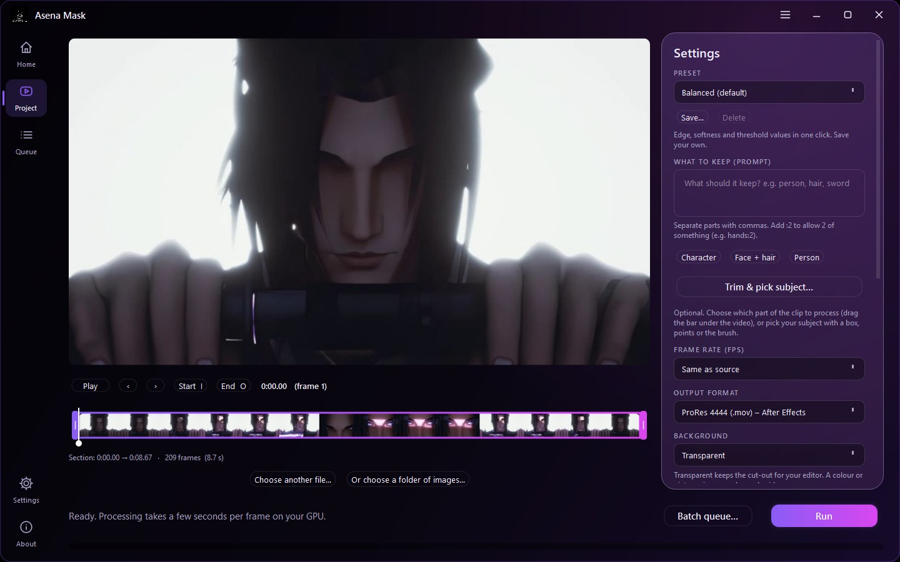
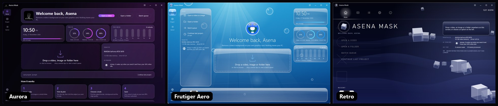
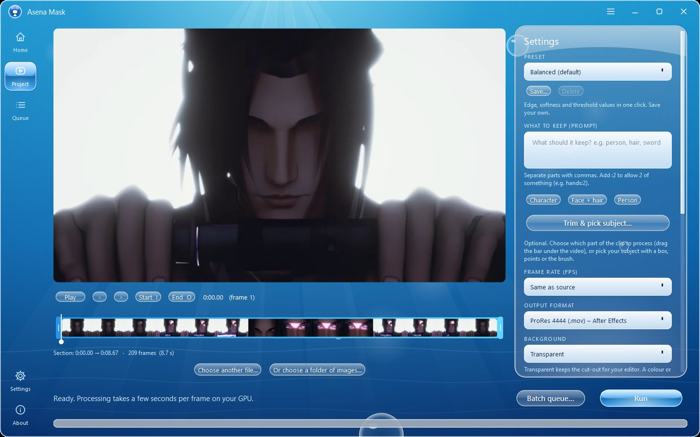
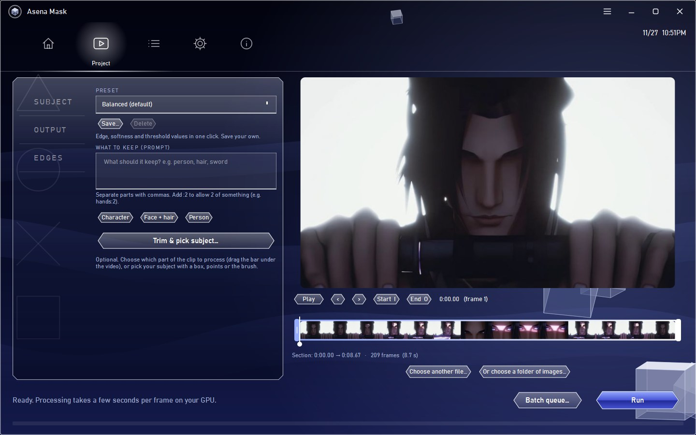

<a href="https://github.com/asenavfx/asena-mask/releases/latest"><b>⬇ Download for Windows</b></a> · <a href="https://asenatools.com">asenatools.com</a> · <a href="https://www.instagram.com/asenavfx/">Instagram</a>

# Asena Mask

AI video cut-outs for Windows. Pick a subject with a box, points or a brush, and Asena Mask tracks it through the whole clip with Meta's SAM 3.1. Then export a clean alpha matte, a transparent video, or the subject over a new background. Everything runs on your own PC.

Free and open source (GPL-3.0). Made by [Asenavfx](https://www.instagram.com/asenavfx/) · [asenatools.com](https://asenatools.com)

## Download

Get **Asena Mask Setup.exe** from the [Releases](../../releases) page. The installer sets up Python, PyTorch for your graphics card, and downloads the SAM 3.1 model from Hugging Face.

## What it does

- **Pick the subject** with boxes, points or brush strokes on one or more frames. Dashed markers show where it moves between picked frames.
- **Stability**: smooths flicker, holes and torn edges between frames.
- **Edge cleanup**: removes the coloured halo of the old background.
- **Duplicate frames** (anime, slideshows) are processed once and reused, so they're faster and don't flicker.
- **Backgrounds**: transparent, blurred original, gradients.
- **Presets**: Fast preview, Best quality, Clean anime edge, Soft hair / fur, Tight cut.
- **Glitch report**: after a job, lists the times where the cut-out may have slipped, so you can fix them in Trim.

## Three looks

Pick the one you like in Settings: **Aurora**, the Windows 7 style **Frutiger Aero**, or the retro-console **Retro**.

<table><tr><td></td><td></td></tr></table>

## Privacy

- Anonymous usage stats and the Discord "Playing Asena Mask" status are both **off by default**. Turn them on in Settings > Privacy, which also shows exactly what would be sent.
- Updates are signed: the app only installs an update whose `version.json` carries a valid Ed25519 signature.

## Run from source

1. Python 3.13, then `python -m venv venv` and `venv\Scripts\pip install -r requirements.txt`, plus PyTorch for your GPU from [pytorch.org](https://pytorch.org).
2. Get [ComfyUI](https://github.com/comfyanonymous/ComfyUI) and point `ASENA_COMFY` at its folder (or put it in `engine\ComfyUI`).
3. `venv\Scripts\python main.py`. Set `ASENA_DEMO=1` to try the interface without the AI.

More developer notes are in [NOTES-FOR-DEVELOPERS.txt](NOTES-FOR-DEVELOPERS.txt).

## Licence

The code is free software under the [GNU GPL v3.0 or later](LICENSE). It has to be GPL because it runs ComfyUI, which is GPL-3.0.

The artwork in `asenamask/assets/` (icon, logo, logo animation, sounds) is © Asenavfx, all rights reserved. It is included so the app builds and runs. Use your own artwork if you publish a modified version.

The SAM 3.1 model is not included. It is downloaded from Hugging Face and is covered by Meta's [SAM License](https://github.com/facebookresearch/sam3). See [THIRD_PARTY_NOTICES.txt](THIRD_PARTY_NOTICES.txt) for everything else. This project is not affiliated with Meta or Comfy Org.
